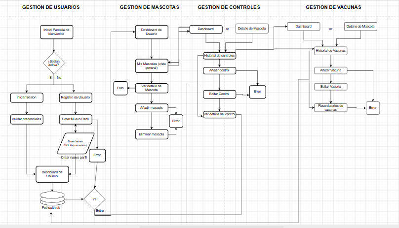
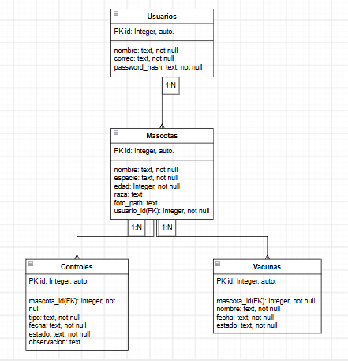

# PetHealth

PetHealth es una aplicación Android orientada al registro y seguimiento de información relacionada con la salud de las mascotas. El proyecto se desarrolla de forma progresiva durante la asignatura de Programación Android.

## Objetivo

El objetivo de PetHealth es mantener en un solo lugar la información básica de las mascotas y facilitar el acceso a sus controles, vacunas y otros registros de cuidado asociados al usuario que mantiene la sesión iniciada.

## Funcionalidades actuales

Actualmente el proyecto cuenta con:

- registro e inicio de sesión de usuarios;
- sesión de usuario mediante `SharedPreferences`;
- registro y administración de mascotas;
- detalle y edición de mascotas;
- fotografía de la mascota desde la cámara;
- registro, visualización y edición de controles;
- registro, visualización y edición de vacunas;
- módulo de desparasitación con formulario y pantalla de consulta, cuya persistencia completa en SQLite todavía se encuentra pendiente;
- almacenamiento local mediante SQLite.

## Tecnologías utilizadas

- Java 17
- XML
- Android Studio
- Gradle Groovy
- SQLite
- SQLiteOpenHelper
- RecyclerView
- SharedPreferences

## Requisitos

- minSdk 29
- compileSdk 35
- targetSdk 35
- Java 17

## Persistencia de datos

PetHealth utiliza SQLite mediante la clase `DatabaseHelper` para almacenar la información local de la aplicación.

La base de datos actual utiliza principalmente las tablas:

- `usuarios`
- `mascotas`
- `controles`
- `vacunas`

Las mascotas se relacionan con el usuario autenticado mediante `usuario_id`, mientras que controles y vacunas utilizan `mascota_id` para identificar a la mascota correspondiente. En la implementación actual estas relaciones se administran mediante identificadores usados por la aplicación; las sentencias de creación de las tablas no declaran restricciones `FOREIGN KEY` de SQLite.

El modelo incluido en este avance se utiliza como representación conceptual de estas relaciones y respeta los campos principales existentes en el proyecto.


## Contract Class

En este avance se incorporó `PetHealthContract` para centralizar los nombres de las tablas y columnas que utiliza SQLite. De esta forma `DatabaseHelper` puede trabajar con constantes comunes y se evita repetir manualmente cadenas como `usuarios`, `mascotas`, `controles`, `vacunas`, `usuario_id` o `mascota_id` en distintas partes de la clase.

La estructura utilizada puede resumirse como:

```text
PetHealthContract → DatabaseHelper → SQLite
```

El Contract representa el esquema que PetHealth ya utilizaba. No se cambiaron nombres de tablas o columnas, no se agregaron restricciones `FOREIGN KEY` y la versión de la base de datos continúa en `5`.

## Diagrama de Navegación

El siguiente diagrama corresponde al material preparado para PetHealth y resume el flujo principal entre gestión de usuarios, mascotas, controles y vacunas.



Además del flujo representado gráficamente, el proyecto actual permite acceder al módulo de desparasitación desde `InicioActivity`. Los identificadores necesarios para editar mascotas, controles o vacunas se transfieren entre Activities mediante `Intent` cuando corresponde.

## Modelo Entidad-Relación

El modelo representa la estructura principal de persistencia usada actualmente por PetHealth: usuarios, mascotas, controles y vacunas.



La tabla de desparasitación no se incorpora en este modelo porque el Avance 21 todavía no implementa su persistencia completa en SQLite.

## Instalación y ejecución

1. Clonar o descargar el proyecto.
2. Abrir la carpeta del proyecto en Android Studio.
3. Esperar que Gradle termine de sincronizar.
4. Ejecutar la aplicación en un emulador o dispositivo Android compatible.

## Avance 23

Este avance continúa la documentación incorporada en el Avance 22 y agrega `PetHealthContract` para ordenar las constantes de SQLite. `DatabaseHelper` fue adaptado para usar el Contract sin cambiar el esquema de la base de datos ni la funcionalidad de Login, sesión, mascotas, controles, vacunas, cámara o navegación.
